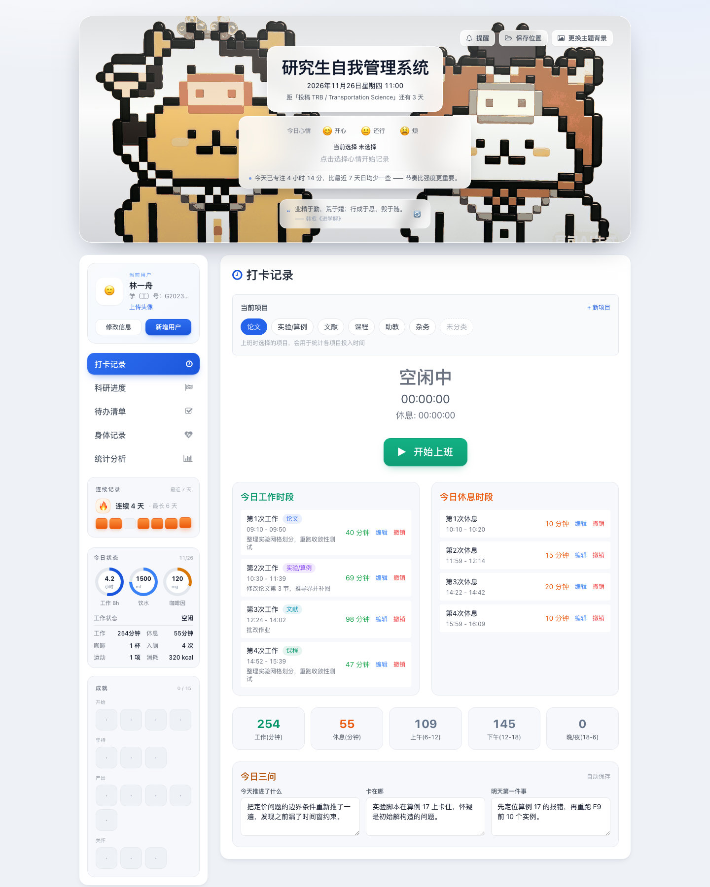
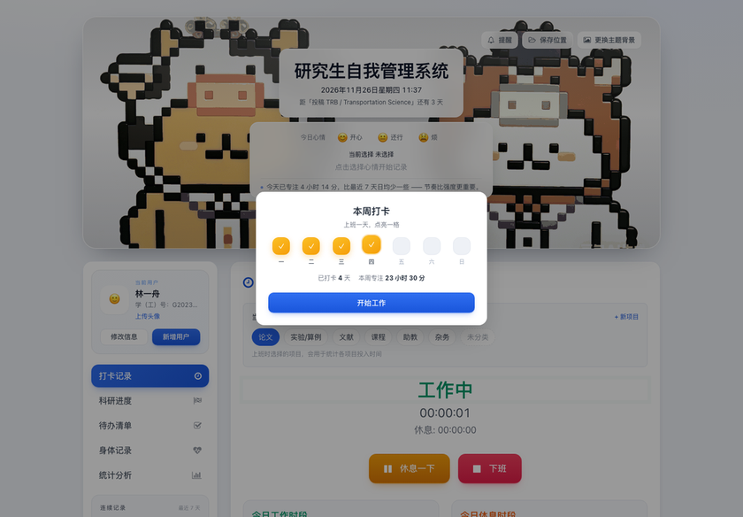
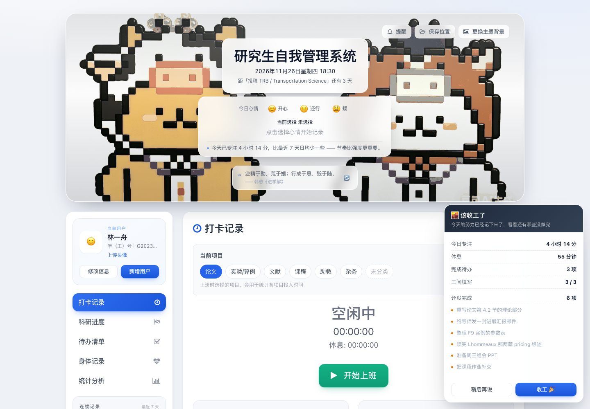
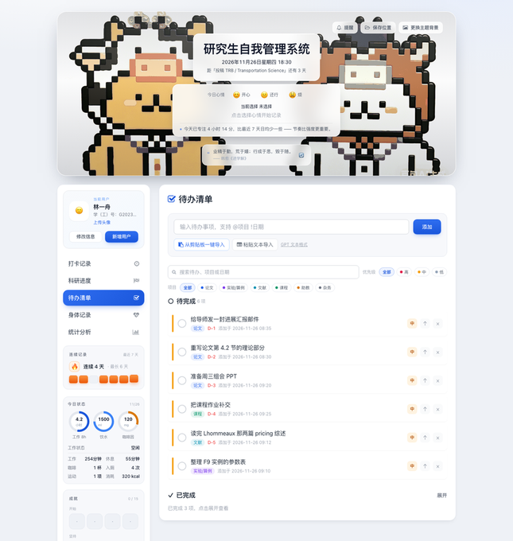
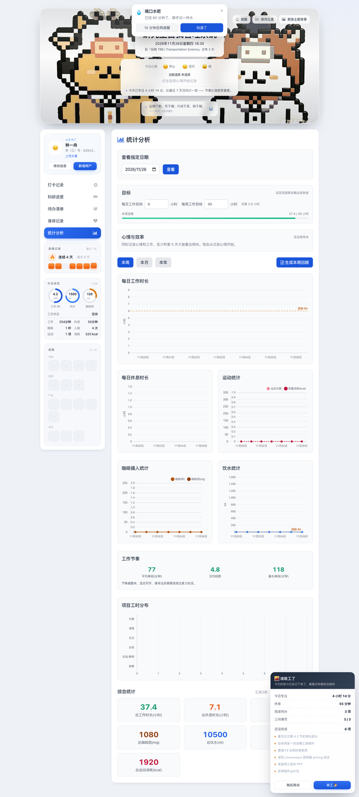
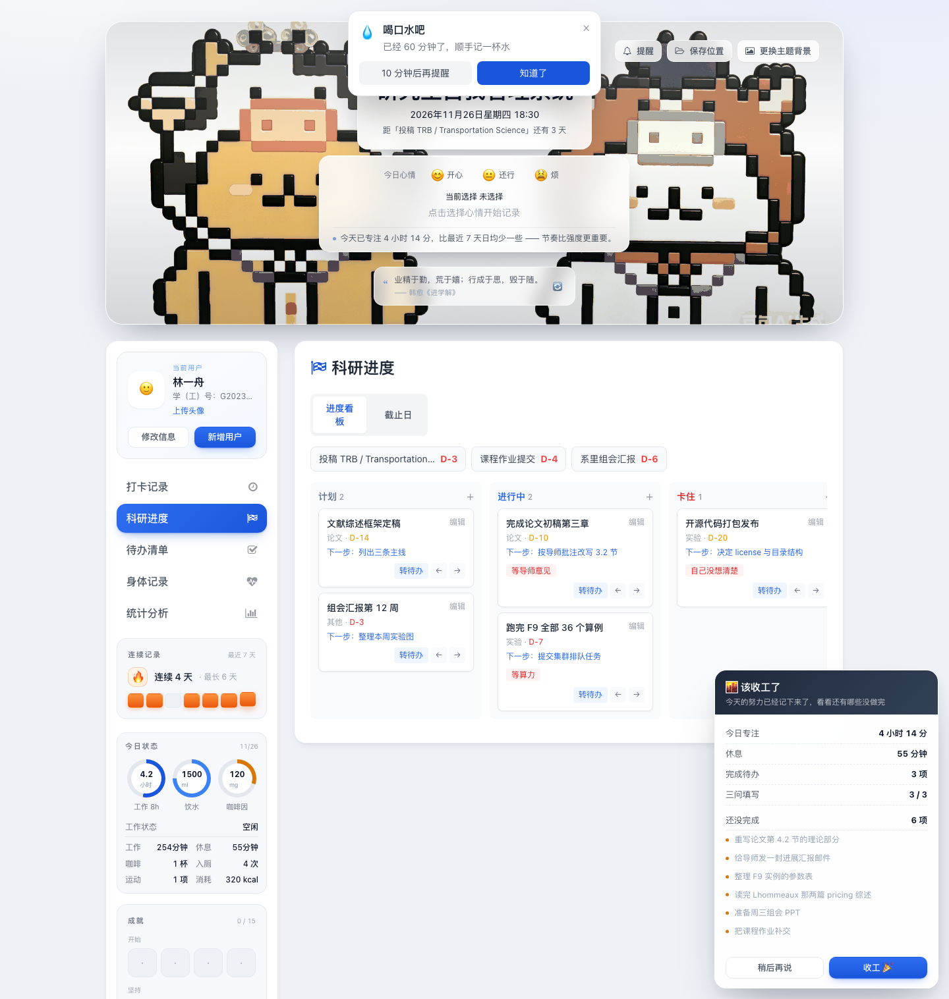
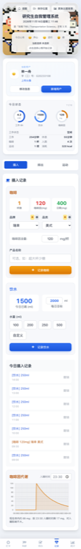

<h1 align="center">研究生自我管理系统</h1>

<br>

<p align="center">
  
</p>

<p align="center">
  组会要汇报、周报要交、导师问「这周做了什么」——<br>
  你只能从头回忆。而回忆，是最不可靠的东西。
</p>

<br>

<p align="center">
  <strong>这个工具不让你更努力。它只做一件事：让你做过的事留得下来。</strong>
</p>

<p align="center">
  
</p>

<br>

<p align="center">
  <a href="#快速开始">快速开始</a> ·
  <a href="#它想解决什么">为什么需要它</a> ·
  <a href="#一天里的四个时刻">四个仪式</a> ·
  <a href="#二次开发说明">溯源</a>
</p>

<br>

<p align="center">
  
</p>

<br>

把工作时段、里程碑、待办、身体状态记进**同一条时间线**。
一个 **单文件、离线可用、数据留在本地** 的工具 —— 下载一个 HTML，双击打开就能用，
不装环境、不连数据库、不上传任何记录。

<div align="center">

| **约 1 MB** | **离线可用** | **26 个本地存储键** | **0 次网络请求** |
|:---:|:---:|:---:|:---:|
| 单个 HTML 文件 | 断网照常用 | 数据只在你浏览器里 | 不需要账号 |

</div>

<p align="center"></p>

<br>

---

## 它想解决什么

上面说的是感受，这里说的是机制。

读研的日子被切成碎片：实验脚本跑着、组会在催、导师的 deadline 卡在明天、论文改到第七版、咖啡已经喝到第三杯、今晚到底要几点睡。

这些事彼此独立，但都记在脑子里，于是全靠回忆 —— 而全靠回忆，就等于全丢。

这个工具把它们收进**同一个页面**，并且只做一件事：

> 把「我今天干了什么」变成一条可以回看、可以统计、可以复盘的时间线。

它**不评价你**。不设排行榜，不算「今日效率分」，不因为你某天只干了三小时就标红。
它只负责把发生过的事原样记下来 —— 该清楚的，是你自己看完之后自然清楚的。

三条硬约束，贯穿全部设计：

<div align="center">

| 单文件 | 离线可用 | 数据本地化 |
|:---:|:---:|:---:|
| 一个 `.html` 就是全部 | 样式、字体、图表、背景图全部内嵌 | 只存在浏览器的 localStorage 里 |
| 双击即用，可直接发给同学 | 断网、飞机上、答辩现场都能用 | 不上传服务器，不需要账号 |

</div>

<br>

---

## 一天里的四个时刻

<p align="left">
  
</p>

大多数记录工具的流程是：**打开 → 记 → 关上**。
这个工具想在一天里留四个**值得停一下的瞬间**。

<br>

### 🌅 早上 —— 一天从一张图开始

<p align="center">
  
</p>

每天第一次打开，全屏是你自己的主题背景。**点一下**，欢迎卡片浮现：

> **早上好，林一舟**
> 2026年11月26日 星期四
>
> *业精于勤，荒于嬉；行成于思，毁于随。* —— 韩愈《进学解》
>
> `4 小时 14 分` 今日专注 · `3 天` 连续天数 · `6` 待办

<br>

### ☀️ 早上 —— 上班的时候，本周亮一格

<p align="center">
  
</p>

第一次「开始上班」，弹窗展示本周七格。**上班一天，点亮一格。**

走到周五，会多出一条横幅：

> 🎉 走到周五了 —— **再坚持一天，happy weekend！**

<br>

### 🌆 傍晚 —— 17:00，提醒你收工

<p align="center">
  
</p>

过了 17:00（且今天专注满 30 分钟），右下角浮出一块：

```
🌆 该收工了
   今日专注  4 小时 14 分      休息  55 分钟
   完成待办  3 项              三问填写  2 / 3
   ────────────────────────────────
   还没完成
   · 重写论文第 4.2 节的理论部分
   · 读完 Lhommeaux 那两篇 pricing 综述
```

**把没做完的事摆在你面前，然后让你走。** 不催、不批、不打分。

<br>

### 🎉 傍晚 —— 恭喜下班

<p align="center">
  
</p>

点「收工 🎉」，彩纸落下。

> **恭喜下班**
> 今天的事都记在这里了，剩下的交给明天。
>
> `4 小时 14 分` 今日专注 · `4` 完成事项 · `3` 连续天数

<br>

> 这四个仪式都**按天去重**。欢迎仪式与下班庆祝当天各出现一次，周打卡弹窗只在当天第一次上班时出现。
> 下班提示点「稍后再说」后不再打扰。

<br>

---

## 它还做了什么

<div align="center">

<table>
<tr>
<td width="50%" valign="top">

**⏱ 工作与休息**

工作 / 休息双态计时，实时显示已计时长。
每段工作可挂**项目标签**并写一句产出。
休息段单独计时 —— 休息也是记录的一部分。

**🚩 科研进度看板**

里程碑按 **计划 / 进行中 / 卡住 / 完成** 四态流转。
卡住时标注阻塞原因与下一步动作，下一步可一键转成待办。
看板横向滚动 + 固定列宽，四列永远等宽。

**✅ 待办清单**

支持 `@项目` 与 `!日期`。
从 GPT 输出的整段文本一键导入，自动识别待办 / 里程碑 / 截止日 / 三问。
拖拽排序、搜索、优先级三档、按项目筛选。

</td>
<td width="50%" valign="top">

**🔔 提醒**

喝水间隔提醒 + 自定义闹钟（每天 / 工作日 / 仅一次）。
提醒文案可用 `{work}` 插入当天已工作时长。
已授权通知时同时发系统通知。

**📝 每日三问**

今天推进了什么 / 卡在哪 / 明天第一件事。
输入即自动保存，昨天的问题会主动递给你。

**💪 身体记录**

咖啡（品牌 / 品类 / 咖啡因毫克数）、饮水、如厕、运动。
**咖啡因代谢曲线**按 5 小时半衰期估算体内残余量，
结合入睡时间给出对睡眠的影响判断。

**📊 统计分析**

本周 / 近 30 天 / 近 12 个月三个周期，图表与汇总卡**同口径**。
项目工时分布、工作节奏、心情 × 效率关联。
目标线直接画在图表上。

</td>
</tr>
</table>

</div>

<br>

### 每日名言

首页底部常驻一句。**同一天永远是同一句**，跨天自动更换。

内置 32 条，均标注出处 —— 屈原、荀子、韩愈、苏轼、诸葛亮，也有 Steve Jobs、Aristotle。
也可以在设置里加一句自己的。

<p align="center">
  
</p>

<br>

### 反馈闭环

不是每个工具都会告诉你「你今天做得不错」。这个会。

**15 条成就**，分「开始 / 坚持 / 产出 / 关怀」四组。
解锁时右下角弹出一张玻璃卡片，2.6 秒后淡出。

<p align="center">
  
</p>

刻意**不做**等级、分数、排行榜 —— 对研究生来说，「你超过了 87% 的人」是纯噪音。
成就只做两件事：让你看见自己做过的事，以及在某个具体行为发生时，给一个明确的正反馈。

<br>

<table>
<tr>
<td width="330" align="center">
  
</td>
<td width="26">
</td>
<td valign="middle">
  <p>
    所以它只负责把发生过的事<strong>原样记下来</strong> ——<br>
    该清楚的，是你自己看完之后自然清楚的。
  </p>
</td>
</tr>
</table>

<br>

---

## 命令面板

<p align="center">
  
</p>

按 `⌘K` 打开。20 条命令，模糊匹配。

搜不到已注册的命令时，它会**降级成「添加待办：<你输入的>」** —— 任何一句话都能直接变成待办。

<br>

### 键盘

| 键 | 作用 | 键 | 作用 |
|---|---|---|---|
| <kbd>1</kbd>–<kbd>5</kbd> | 切换模块 | <kbd>N</kbd> | 新建待办 |
| <kbd>W</kbd> | 开始上班 | <kbd>S</kbd> | 收工 |
| <kbd>R</kbd> | 休息一下 | <kbd>/</kbd> | 搜索待办 |
| <kbd>?</kbd> | 快捷键面板 | <kbd>⌘K</kbd> | 命令面板 |

<br>

---

## 界面

<p align="center">
  
  
</p>

<p align="center">
  <sub>待办清单 —— 搜索、优先级、项目筛选、拖拽排序</sub>
  <sub>统计分析 —— 三周期、目标线、心情关联</sub>
</p>

<br>

<p align="center">
  
</p>

<p align="center">
  <sub>科研进度看板 —— 四态流转，横向滚动 + 固定列宽</sub>
</p>

<br>

<p align="center">
  
  
  
</p>

<p align="center">
  <sub>移动端 —— 底部标签栏，与桌面端同一套数据</sub>
</p>

<br>

---

## 快速开始

```bash
# 方式一：直接双击
open 研究生自我管理系统.html

# 方式二：起个静态服务（推荐，手机同局域网可访问）
python3 -m http.server 8000
# 浏览器打开 http://localhost:8000
```

无需 `npm install`，无需构建。

首次打开会载入内置样例数据填充图表。
在「更换主题背景 → 保存位置 → 导入数据」里导入自己的 JSON 即可覆盖。

<br>

---

## 数据与隐私

页面数据保存在**浏览器的 localStorage** 里（26 个键），不上传服务器，不依赖网络。

- **容量上限**：localStorage 一般约 5 MB。应用自身约 1.3 MB，余量尚可；
  写入失败时页面会提示「本地存储空间不足，部分内容未成功保存」。
- **换浏览器 / 清缓存会丢**：无痕窗口关闭即清空。
- **定期备份**：右上角「保存位置」导出 JSON，可从同一入口恢复。
- **导入是整库覆盖**：不做合并。导入前先导出一份。

仓库里不含任何个人记录，`.gitignore` 已排除本地导出文件。

### 提醒机制

喝水提醒与自定义闹钟由**页面内的定时器**驱动，每 15 秒检查一次。

- **页面必须保持打开**：关掉标签页、退出浏览器或让电脑休眠，闹钟都不会响。
- 已授权通知权限时同时发系统通知；未授权时只有页面内横幅和提示音。

需要「关掉浏览器也能响」的提醒，请用系统自带的时钟 / 闹钟应用。本页面只负责记录，不替代系统提醒。

<br>

---

## 二次开发说明

本项目**基于 [Echo253/Graduate-self-management-records](https://github.com/Echo253/Graduate-self-management-records) 二次开发**，
上游作者 **Echo253**，原始仓库 46 stars / 2 forks。

本仓库是上游仓库的 **GitHub 官方 fork**，父子关系在 GitHub 数据模型中真实建立：

| 分支 | 来源 | 说明 |
|---|---|---|
| `html-v1` | 上游原样 | 上游的 HTML 单文件版本，未做任何改动 |
| `nextjs-app-v2` | 上游原样 | 上游的 Next.js 全栈版本（由 tktogether 贡献），未改动 |
| `main` | **本仓库** | 二次开发主线，基于 `html-v1` 深度改造 |

**相对上游的主要改动**

- **新增**：科研进度看板、截止日倒计时、提醒机制、每日三问、咖啡因代谢曲线、
  每日仪式、每日名言、成就系统、待办搜索 / 优先级 / 拖拽、目标与目标线、心情 × 效率关联
- **重做**：统计口径统一（三周期，图表与汇总卡同区间）；界面加入 440 行设计系统层
- **修复**：`break-all` 切断英文单词；摄入记录未转义；失效的 `btn-shadow` 规则；日期键跨时区错位
- **工程**：5 套回归脚本（96 项断言），全部通过，控制台零异常

逐项清单见 **[UPSTREAM.md](UPSTREAM.md)**，逐行 diff 见
**[html-v1...main](https://github.com/Dalianmaritime/graduate-self-management/compare/html-v1...main)**。

<br>

---

## 技术实现

<details>
<summary><b>展开查看技术细节</b></summary>

<br>

| 项 | 选择 | 理由 |
|---|---|---|
| 交付形态 | 单文件 HTML（约 1 MB） | 双击即用，可直接发给同学 |
| 样式 | Tailwind CSS 3.4.17（构建期产物） | 无需运行时 JIT，首屏不再下载并执行编译器 |
| 设计令牌 | 手写 `<style id="design-system">`（约 45 KB） | 与运行时 utility 分层，改一处全局生效 |
| 图表 | Chart.js 4.4.8（7 个实例） | 内嵌 UMD，离线可用 |
| 图标 | Font Awesome 4.7.0 | 内嵌字体文件，离线可用 |
| 主题背景 | 内嵌 PNG（1120×536，48 色索引） | 离线可用；`image-rendering: pixelated` 保持像素画硬边 |
| 存储 | localStorage（26 个键） | 无后端、零配置 |
| 动画 | CSS transition / keyframes | 不引动画库，体积可控 |

**关键实现**

- **样式是构建期产物**：Tailwind 的运行时 JIT 编译器已移除，换成 56 KB 的静态 CSS。
  页面里那些运行时才拼出来的类（`bg-blue-100`、`text-primary` 等）列在
  `tools/tailwind/tailwind.config.js` 的 `safelist` 里，改页面时需同步维护
- **统计口径统一**：`getStatsRangeDates()` 驱动图表与汇总卡，两者永不打架
- **目标线用 Chart.js 插件实现**：塞进 `options.plugins` 在 v4 下不生效，必须 `Chart.register()`
- **图表联动**：5 个统计图共享 crosshair，悬停时同步高亮同一位置
- **像素画背景**：默认图预缩到容器尺寸的整数倍，配 `image-rendering: pixelated`，
  色块边界硬边占比从 39.5% 提升到 94.3%
- **日期键用本地时区**：`getTodayString()` 早前用 UTC，东八区凌晨 8 小时内会返回前一天
- **统计诚实性**：心情 × 效率关联在样本量 < 5 时不输出任何结论
- **可访问性**：`prefers-reduced-motion` 时全部动效降级为瞬时
- **README 的视觉约束**：GitHub 会剥离大部分内联 `style` 属性（`font-family`、
  `background-color`、`padding` 等）与 `<style>` 标签，因此本页的手绘元素
  （手写体、便签、下划线）全部做进 `docs/handwriting/` 下的 SVG，
  README 只用 `` 引用 —— SVG 内部不受影响
- **手写元素不依赖系统字体**：原本用 `font-family="Hannotate SC"`（macOS 自带），
  别的平台没有会回退成普通字体。现已用 `tools/svg-text2path/` 把文字
  转成轮廓路径，**任何系统上渲染完全一致**

</details>

<br>

<details>
<summary><b>展开查看仓库结构与验证脚本</b></summary>

<br>

```
.
├── 研究生自我管理系统.html    # 主页面（全部功能与样式，约 1 MB）
├── initial-data.json           # 初始化数据模板 / 导入示例
├── docs/screenshots/            # README 配图
├── tools/
│   ├── seed.js                 # 生成两周样例数据（schema 与页面一致）
│   ├── smoke.js                # 17 项交互冒烟
│   ├── verify-stats.js         # 三区间统计口径独立复算
│   ├── verify-v5.js            # 32 项新功能验证
│   ├── verify-ritual.js        # 31 项仪式感验证
│   ├── verify-timezone.js      # 10 项时区验证
│   ├── tailwind/               # Tailwind 构建期产物：config + build.sh + 说明
│   └── svg-text2path/          # SVG 文字转路径：消除对系统字体的依赖
├── UPSTREAM.md                 # 二次开发溯源：上游、基线、改动清单
├── LICENSE
└── README.md
```

**Tailwind 构建**：页面里的 `<style id="tailwind-build">` 是构建期产物，
由 `tools/tailwind/build.sh` 扫描 HTML 生成并自动注入。改页面新增了动态类时，
记得同步 `tools/tailwind/tailwind.config.js` 里的 `safelist`。

```bash
cd tools/tailwind && npm install && ./build.sh
```

**验证脚本**基于 headless Chrome 的 CDP 协议驱动真实页面，自己起静态服务与浏览器，不需要手动准备环境。

```bash
node tools/smoke.js           # 17 项交互
node tools/verify-stats.js    # 统计口径三区间
node tools/verify-v5.js       # 32 项新功能
node tools/verify-ritual.js   # 31 项仪式感
node tools/verify-timezone.js # 10 项时区
```

统计期望值全部从种子数据实时复算，**不写死任何数字** —— 任何一天运行都成立。

</details>

<br>

---

## 已知限制

| 限制 | 说明 |
|---|---|
| 存储上限 | localStorage 约 5 MB，应用自身约 1.3 MB，余量尚可 |
| 提醒依赖页面存活 | 关掉浏览器就不会响，需配合系统闹钟 |
| 历史凌晨记录 | 时区修复前 00:00–08:00 记的记录存在前一天键下，仍在原处，不会自动迁回 |
| 导入是整库覆盖 | 不做增量合并，导入前需先导出 |

## 路线图

- [x] Tailwind Play CDN 改为构建期产物，去掉运行时 JIT
- [ ] 数据层由 localStorage 迁移到 IndexedDB
- [ ] 待办支持子任务与附件
- [ ] 图表增加「对比上周」与周报导出
- [ ] 暗色模式（需先把硬编码 utility 收敛成语义类）

<br>

---

## 许可

本仓库代码以 [MIT](LICENSE) 发布 © 2026 Charile_Hao (Dalianmaritime)。

**上游项目** [Echo253/Graduate-self-management-records](https://github.com/Echo253/Graduate-self-management-records)
在 GitHub 上未附带 LICENSE 文件，其原始代码版权归原作者 Echo253 所有。
本仓库为上游项目的 fork，`html-v1` 与 `nextjs-app-v2` 两个分支完整保留上游原始内容，
所有二次开发改动均集中在 `main` 分支。若需以本仓库代码为基础再分发，
请同时遵守上游项目的授权约定并向上游作者致谢。

<p align="center">
  <sub>Made with ☕ and too many late nights.</sub>
</p>
