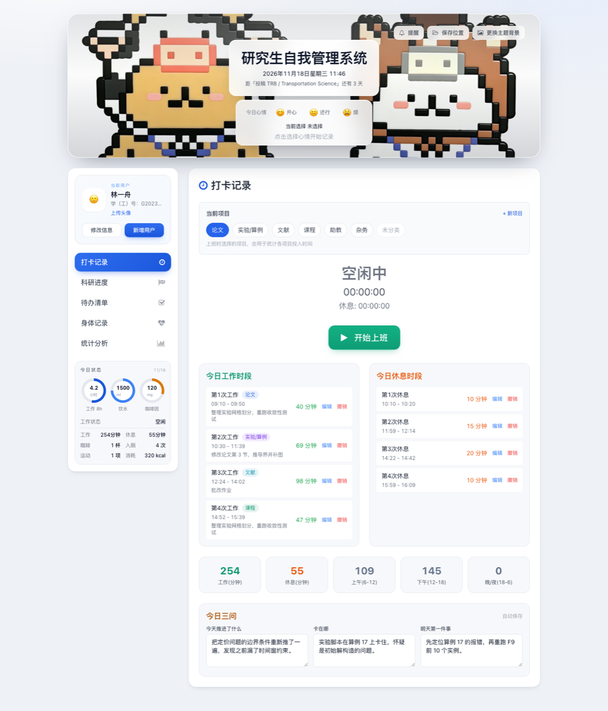
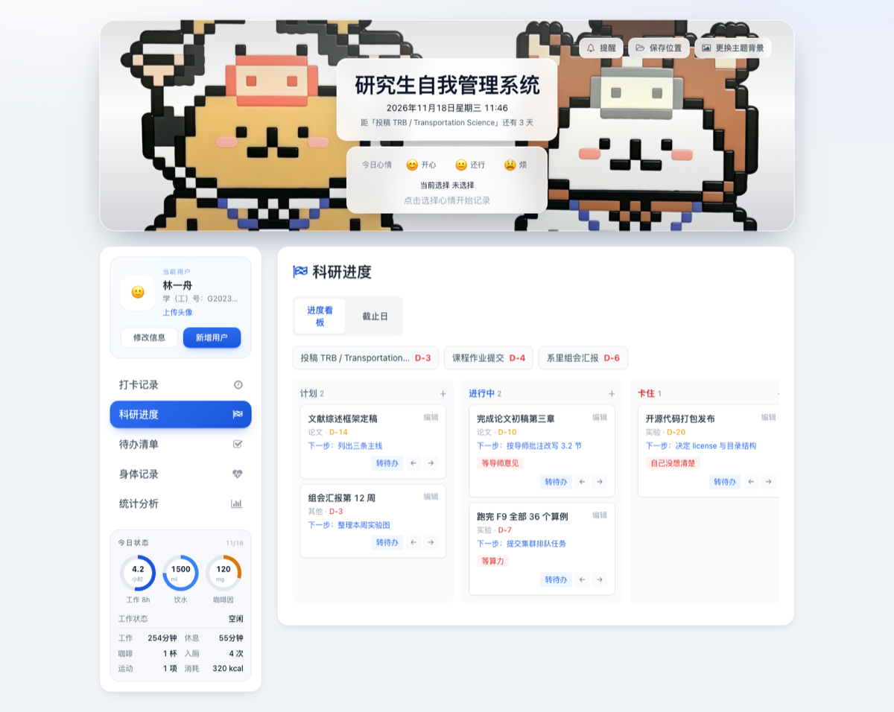
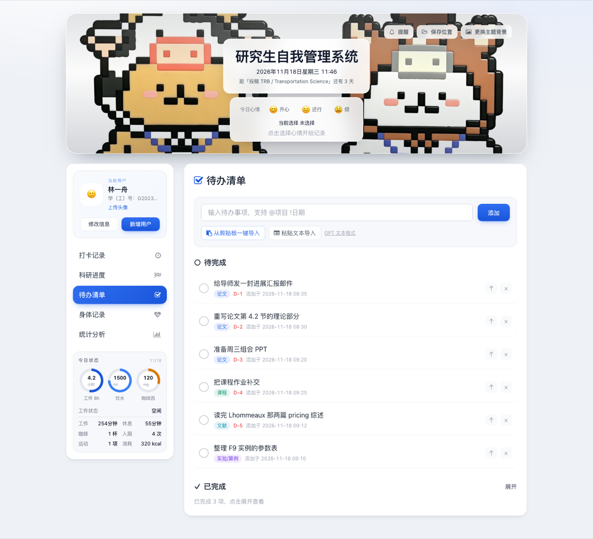
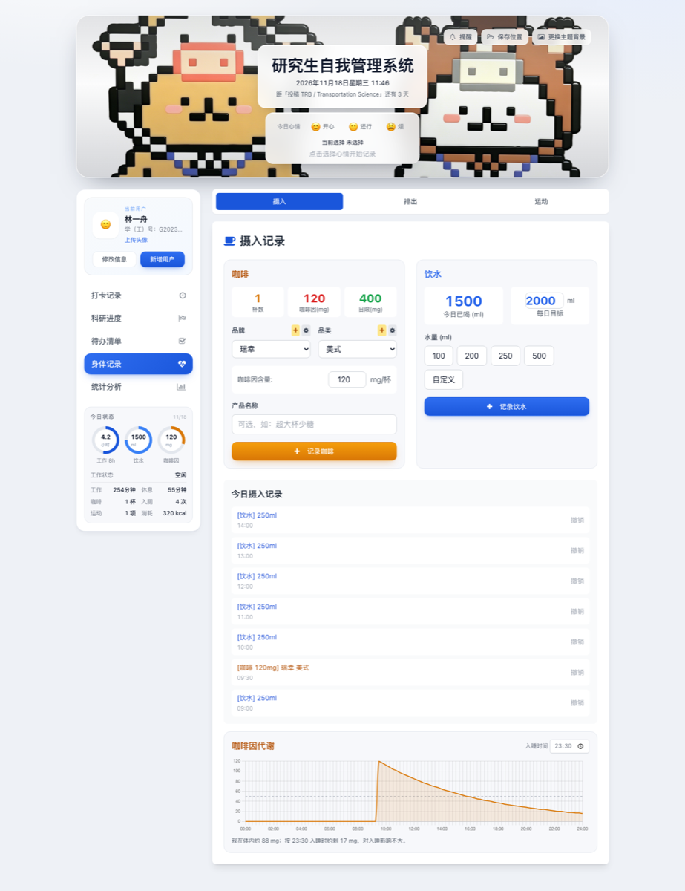
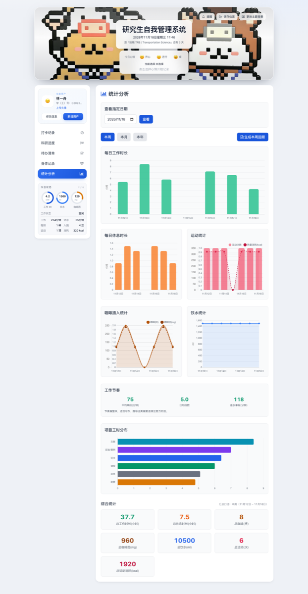
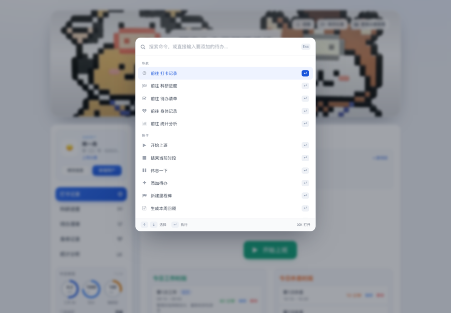

# 研究生自我管理系统

> 一个**单文件、离线可用、数据留在本地**的研究生自我管理工具。
> 打开一个 HTML 文件就能用：记录工作时段、管理科研里程碑、盯待办、跟踪身体状态、复盘统计。



---

## 目录

- [它解决什么问题](#它解决什么问题)
- [快速开始](#快速开始)
- [功能总览](#功能总览)
- [界面](#界面)
- [设计系统](#设计系统)
- [数据与隐私](#数据与隐私)
- [提醒机制](#提醒机制)
- [技术实现](#技术实现)
- [仓库结构](#仓库结构)
- [验证与测试](#验证与测试)
- [已知限制](#已知限制)
- [路线图](#路线图)
- [许可](#许可)

---

## 它解决什么问题

读研的日子被切成碎片：实验脚本跑着、组会在催、导师的 deadline 卡在明天、论文改到第七版、
咖啡已经喝到第三杯、今晚到底要几点睡。这些事彼此独立，但都记在脑子里，于是全靠回忆，
全靠回忆就等于全丢。

这个工具把这些分散的记录收进**同一个页面**，并且只做一件事：

> **把「我今天干了什么」变成一条可以回看、可以统计、可以复盘的时间线。**

设计上有三条硬约束：

| 约束 | 含义 |
|---|---|
| **单文件** | 一个 `.html` 就是全部。双击即用，不装环境、不建服务器、不连数据库。 |
| **离线可用** | Tailwind / Chart.js / FontAwesome / 主题背景全部内嵌。断网、飞机上、答辩现场都能用。 |
| **数据本地化** | 记录只存在浏览器的 localStorage 里，不上传任何服务器，不需要账号。 |

---

## 快速开始

```bash
# 方式一：直接双击
open 研究生自我管理系统.html

# 方式二：本地起个静态服务（推荐，移动端同局域网可访问）
python3 -m http.server 8000
# 浏览器打开 http://localhost:8000
```

无需 `npm install`，无需构建。首次打开会载入内置样例数据以填充图表，
在「设置 → 保存位置」导入自己的 JSON 即可覆盖。

---

## 功能总览

### 打卡记录

- 工作 / 休息双态计时，实时显示已计时长，状态带呼吸脉冲动效
- 每段工作可挂**项目标签**并写一句产出记录（「整理实验网格划分，重跑收敛性测试」）
- 休息段单独计时，统计页里工作与休息分开呈现
- 当日记录时间线，倒序排列，一眼看出今天的时间去了哪儿

### 科研进度看板

- 里程碑按 **计划 / 进行中 / 卡住 / 完成** 四态流转
- 卡住时可标注**阻塞原因**与**下一步动作**，下一步一键转成待办
- 看板采用**横向滚动 + 固定列宽**（`flex: 1 0 260px`），列宽不随内容漂移，
  窄屏下也能横向浏览全部四列而不挤压变形

### 待办清单

- 支持 `@项目` 标签与 `!日期` 后缀
- 从 GPT 输出的整段文本**一键导入**，自动识别待办 / 里程碑 / 截止日 / 三问
- 勾选时有对勾绘制与删除线扫过动画，完成动作有即时反馈

### 截止日倒计时

- 投稿、会议、组会节点集中管理，首页显示最近一个
- 到期前有分级提醒

### 提醒

- 喝水间隔提醒 + 自定义闹钟（午饭、收工等）
- 闹钟支持 `每天 / 工作日 / 仅一次` 三种重复模式
- 提醒文案可用 `{work}` 占位符插入当天已工作时长
- 已授权通知权限时同时发系统通知，否则退化为页面内横幅 + 提示音

### 每日三问

- 今天推进了什么 / 卡在哪 / 明天第一件事，输入即自动保存

### 身体记录

- 摄入：咖啡（记录品牌、品类、咖啡因毫克数）、饮水
- 排出：如厕
- 运动：球类项目 + 自定义运动类型 + 时长
- **咖啡因代谢曲线**：按 5 小时半衰期（`halfLife = 300` 分钟）估算体内残余量，
  并结合设定的入睡时间给出对睡眠的影响判断

### 统计分析

- 项目工时分布、工作节奏（平均单段时长 / 日均段数 / 最长单段）
- 三个统计周期：**本周 / 近 30 天 / 近 12 个月**，切换后图表与底部汇总卡**同步换算**
- 图表卡片采用中性底色（`bg-gray-50` + 灰色描边），**只有数据系列上色**，
  避免界面被彩色块切割；五个指标各归一个色族（工作 / 休息 / 咖啡 / 饮水 / 运动）
- 周回顾：汇总最近 7 天的工时、项目、里程碑、待办、身体数据与三问，一键复制

### 全局

- **⌘K 命令面板**：18 条命令，模糊匹配；搜不到已注册命令时，
  自动降级为「添加待办：<你的输入>」，任意一句话都能变成待办
- 用户信息、头像、主题背景可自定义
- 数据导出 / 导入 JSON

---

## 界面

### 打卡记录


### 科研进度看板



### 待办清单



### 身体记录



### 统计分析



### 命令面板（⌘K）



### 移动端

底部标签栏切换模块，桌面端左侧导航。

<p align="center">
  
  
  
</p>

---

## 设计系统

界面样式集中在 `<style id="design-system">`（约 440 行）里，与业务逻辑分离。

**设计令牌**

- 颜色、圆角、四级阴影（`--sh-1` … `--sh-4`）、四级动效时长（`--d-1` … `--d-4`）
- 统一的缓动曲线 `--ease`

**组件**

`panel` / `panel-soft` / `btn--primary|ghost|glass|ok|warn|danger` / `hero-dock` /
`stat-ring` / `cmdk-key` / `todo-check` / `strike-sweep` / `board-card` /
`project-chip` / `todo-row` / `lift-card`

**动效**

区块切换错落入场、弹窗与 Toast 淡入上浮、汇总数字滚动、待办勾选画对勾、
计时器呼吸脉冲、侧栏导航滑动指示器。

**可访问性**

- `prefers-reduced-motion: reduce` 时全部动效降级为瞬时切换
- 统一的 `focus-visible` 焦点环
- 图表与数字同时提供，不依赖颜色单独传达信息

---

## 数据与隐私

页面数据保存在**浏览器的 localStorage** 中，不上传服务器，不依赖网络。

- **容量上限**：localStorage 一般约 5 MB。页面自身内嵌约 4 MB 的样式、图标与主题背景资源，
  留给记录的余量有限；写入失败时页面会提示「本地存储空间不足，部分内容未成功保存」。
- **更换浏览器或清除浏览器数据会丢失记录**：无痕窗口关闭即清空。
- **定期备份**：用右上角「保存位置」导出 JSON。导出文件包含全部记录，
  可通过同一入口的「导入数据」恢复。
- **导入为整库覆盖**：导入会替换当前全部数据，不做合并。导入前请先导出一份当前数据。

代码仓库中不包含任何个人记录；`.gitignore` 已排除本地导出文件。

---

## 提醒机制

喝水提醒与自定义闹钟由**页面内的定时器**驱动，页面每 15 秒检查一次。

- **页面必须保持打开**：关闭标签页、退出浏览器或让电脑休眠后，
  闹钟与喝水提醒都不会触发，系统通知也不会送达。
- 浏览器若已授予通知权限，会同时弹出系统通知；未授权时只有页面内横幅和提示音。
- 闹钟支持「每天 / 工作日 / 仅一次」，提醒文字里可用 `{work}` 代表当天已工作时长。

若需要「关掉浏览器也能响」的提醒，应改用系统自带的时钟 / 闹钟应用；
本页面只负责记录，不替代系统提醒。

---

## 技术实现

| 项 | 选择 | 理由 |
|---|---|---|
| 交付形态 | 单文件 HTML（约 4.0 MB） | 双击即用，可直接发给同学或存档 |
| 样式 | Tailwind Play CDN（运行时 JIT） | 任意值类如 `shadow-[...]` 随手可用，无需构建链 |
| 设计令牌 | 手写 `<style id="design-system">` | 与运行时 utility 分层，改一处即可全局生效 |
| 图表 | Chart.js 4.4.8 | 内嵌 UMD 构建，离线可用 |
| 图标 | Font Awesome 4.7.0 | 内嵌字体文件，离线可用 |
| 主题背景 | 内嵌 base64 PNG | 离线可用；代价是文件体积（占约 2.3 MB） |
| 存储 | localStorage（22 个键） | 无后端、零配置 |
| 动画 | CSS transition / keyframes | 不引入动画库，体积可控 |

关键实现细节：

- **统计口径统一**：新增 `getStatsRangeDates()` / `getStatsRangeLabel()`，
  模块级 `statsPeriod` 统一驱动图表与汇总卡；切换区块时不再重置为「本周」。
- **图表不重建**：六个图表函数改为「已存在则原地 `update()`」，
  避免每次切页重播入场动画。
- **文本安全**：`updateIntakeDisplay` / `updateExerciseDisplay` 使用 `escapeHtml` 转义。
- **断词正确**：长英文用 `break-words` 而非 `break-all`，避免单词被从中间切断。

---

## 仓库结构

```
.
├── 研究生自我管理系统.html    # 主页面（全部功能与样式）
├── initial-data.json           # 初始化数据模板 / 导入示例
├── docs/
│   └── screenshots/            # README 配图
├── tools/
│   ├── seed.js                 # 生成两周样例数据（schema 与页面一致）
│   ├── smoke.js                # 18 项交互冒烟测试（headless Chrome + CDP）
│   └── verify-stats.js         # 统计口径回归：独立复算三区间并比对页面
├── LICENSE
└── README.md
```

---

## 验证与测试

`tools/` 下是本项目自带的验证脚本，基于 headless Chrome 的 CDP 协议驱动真实页面。

```bash
# 交互冒烟：18 项
node tools/smoke.js

# 统计口径回归：本周 / 近 30 天 / 近 12 个月
node tools/verify-stats.js
```

**`smoke.js`** 覆盖心情切换、待办勾选动画、弹窗开合、Toast、命令面板执行与跳转、
统计周期切换与图表实例复用、计时器状态与脉冲类、控制台零异常等。

**`verify-stats.js`** 不信任页面自己的统计结果，而是从种子数据按区间独立复算
（工作时长、休息、咖啡、饮水、运动次数），再与页面显示值逐项比对。

两个脚本都自己起本地静态服务与无头 Chrome，**不需要手动准备环境**，
唯一外部依赖是本机装了 Chrome 或 Chromium。

统计周期的期望值全部由种子数据实时复算，不写死任何数字 ——
因此任何一天运行都成立，不会因为窗口起点移动而失效。

---

## 已知限制

| 限制 | 说明 |
|---|---|
| 存储上限 | localStorage 约 5 MB，页面自身已占约 4 MB，余量有限 |
| 提醒依赖页面存活 | 关掉浏览器就不会响，需配合系统闹钟 |
| Tailwind 运行时 JIT | 首屏需执行一次 JIT 编译，是当前最大的加载开销 |
| 背景图体积 | 2.3 MB base64 PNG 约占文件一半以上 |
| 导入是整库覆盖 | 不做增量合并，导入前需先导出 |
| 统计区间不连续 | 「本周」取最近 7 天，「近 30 天」取最近 30 天，「本年」按自然月滚动 12 个月 |

---

## 路线图

- [ ] Tailwind Play CDN 改为构建期产物，去掉运行时 JIT（首屏最大浪费）
- [ ] 主题背景由 base64 PNG 改为 WebP 或外链资源
- [ ] 数据层由 localStorage 迁移到 IndexedDB（容量与异步 IO）
- [ ] 待办支持优先级、搜索与项目筛选
- [ ] 图表增加「对比上周」与目标线

---

## 许可

[MIT](LICENSE) © 2026 Charile_Hao (Dalianmaritime)
